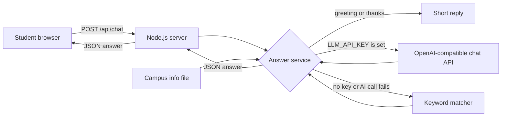

# CampusBuddy

> A mobile-friendly chat app that answers students' campus questions in short, simple language, designed to use only the campus information you provide.

## Team

**Team Name:** [Team Name]


| Member | Contribution   |
| ------ | -------------- |
| [Name] | [Contribution] |
| [Name] | [Contribution] |
| [Name] | [Contribution] |
| [Name] | [Contribution] |


## Problem Statement

### The Problem

Students often need quick answers to everyday campus questions, such as library hours, bus timings, fee payments, or how to replace an ID card. Without a single place to ask, they have to search through notices and documents or visit the college office.

### Why We Chose This Problem

[Team: explain why the team selected this problem and why solving it is important.]

## Solution

CampusBuddy is a chat web app for students. A student types a question in plain language or taps one of four suggested questions. Answers come from the campus information file that the college provides. If that file does not cover the question, CampusBuddy replies:

> I don't have that info, please contact the college office.

### Key Features

- Chat interface for questions in plain language
- Four suggested-question buttons
- Short answers taken from the campus information file
- The exact fallback reply when the information does not cover a question
- Works with no API key (built-in keyword matching)
- Optional AI answers from any OpenAI-compatible chat API (set `LLM_API_KEY`)
- Clean, mobile-friendly layout

## Innovation and Differentiation

- **Grounded answers:** in built-in mode, answers are copied from the college's own file (greetings and the fallback sentence are fixed text), and a question the file does not cover gets the fallback reply instead of a guess. In AI mode, the model is instructed to do the same, so its answers still need review.
- **No account needed to try it:** the built-in mode needs no API key or external service. An AI mode can be turned on with one environment variable.
- **Editable by non-developers:** the campus information is a single Markdown file with simple headings.

## Technical Implementation

### Architecture



### Technology Stack

| Category        | Technologies |
| --------------- | ------------ |
| Frontend        | HTML, CSS and vanilla JavaScript (no framework) |
| Backend         | Node.js with the built-in `http` module (no framework) |
| Database        | N/A (campus information is stored in a Markdown file) |
| AI / ML         | Optional: any OpenAI-compatible Chat Completions model (default `gpt-4.1-mini`). Without a key, built-in keyword matching is used (no machine learning). |
| Infrastructure  | N/A for local use. Any host that can run Node.js 20 or newer. |
| APIs / Services | Optional: an OpenAI-compatible Chat Completions API |

### How It Works

1. The page loads the four suggested questions from `GET /api/suggestions`.
2. Each question is sent to `POST /api/chat` with the last few messages, so follow-up questions work in AI mode.
3. The server answers greetings and thanks directly. Other questions go to the AI model when `LLM_API_KEY` is set. Without a key, or when an AI call fails, they go to the keyword matcher.
4. The answer comes back as JSON and appears in the chat.

### Technical Decisions

- **No runtime dependencies.** Only Node.js built-in modules are used, so there is nothing to install.
- **Campus information in Markdown.** Each `##` heading is a topic and the text under it is the answer. In AI mode, this same text is the only campus information sent to the model.
- **Strict keyword matching.** A topic answers only when it covers every meaningful word in the question. Partial matches get the fallback reply, so students are not shown an answer about something else. The trade-off: in built-in mode, questions that combine two topics, or use words the information does not contain, get the fallback. AI mode handles these better.
- **Exact fallback.** If the AI says it does not have the information, the reply is replaced with the exact fallback sentence.
- **The key stays on the server.** The API key is read from an environment variable. It is never sent to the browser or written to the logs.
- **Safe rendering.** Answers are inserted as plain text, not as HTML.
- **Input limits.** Questions are limited to 500 characters and request bodies to 16 KB.

## Implementation During the Hackathon

[Team: describe what the team built during the Hack Day and the major contributions completed during the event.]

Current contents of this repository:

- Chat web app in `public/`: suggested-question buttons, a typing indicator and a responsive layout
- Node.js server in `src/`: chat API, static files, answer routing, the keyword matcher and the optional AI answerer
- Sample campus information in `data/campus-info.md` (placeholder content to replace with your college's information)
- Automated tests in `tests/`

### Team Contributions

- **[Member Name]:** [Contribution]
- **[Member Name]:** [Contribution]
- **[Member Name]:** [Contribution]
- **[Member Name]:** [Contribution]

## Working Application

**Live Application:** [Live URL]

Run the app locally with the steps in [Setup and Usage](#setup-and-usage), then open http://localhost:3000. Try the four suggested questions, then type your own, for example "What time does the canteen open?". Then try "Is there a swimming pool?", which should get the fallback reply because the sample information does not mention a pool.

## Demo Video

**Demo Video:** [Video URL]

[Briefly show the main flow: open the app, tap a suggestion, ask a question in your own words, and show the fallback reply.]

## Open Source and AI Usage

### AI / Models

- **OpenAI-compatible Chat Completions model (optional):** answers student questions in AI mode. It is instructed to use only the campus information file. AI mode is off unless `LLM_API_KEY` is set. The default model is `gpt-4.1-mini`; set `LLM_MODEL` to use another model name. This repository includes no API key or model. You supply the key and must follow your provider's terms.

### Open Source Components

- **Node.js built-in modules** (`http`, `fs`, `path`, `url`, `node:test`): runtime and test runner. No third-party packages are used.
- **Sample campus information** (`data/campus-info.md`): placeholder text written for this project. Replace it with your college's information.

## Setup and Usage

### Prerequisites

- Node.js 20 or newer (tested with Node.js 22)

### Installation

```bash
git clone https://github.com/uvgopal09-alt/hacktoberfest-hack-day-coimbatore-x-init-club-and-idea-club.git
cd hacktoberfest-hack-day-coimbatore-x-init-club-and-idea-club
```

No `npm install` step is needed, because CampusBuddy has no runtime dependencies.

### Environment Variables

Copy `.env.example` to `.env` and change only what you need. The `.env` file is git-ignored.

| Variable | Required | Default | Purpose |
| -------- | -------- | ------- | ------- |
| `LLM_API_KEY` | No | empty | Turns on AI answers. Leave it empty to use the built-in keyword answers. |
| `LLM_BASE_URL` | No | `https://api.openai.com/v1` | Base URL of an OpenAI-compatible Chat Completions API. |
| `LLM_MODEL` | No | `gpt-4.1-mini` | Model name used with that API. |
| `CAMPUS_INFO_FILE` | No | `data/campus-info.md` | Campus information file, relative to the project folder. |
| `PORT` | No | `3000` | Port for the web server. |
| `HOST` | No | `0.0.0.0` | Address to listen on. Use `127.0.0.1` to accept connections only from this computer. |

### Running the Project

```bash
npm start
```

Open http://localhost:3000. Other devices on the same network can open `http://<this-computer's-IP>:3000` unless `HOST` is set to `127.0.0.1`.

The server reads the campus information when it starts, so restart it after you edit the file.

### Running the Tests

```bash
npm test
```

The tests cover the campus information parser, keyword matching, the AI client (against a local mock of the API), answer routing, the HTTP API, and the shipped sample data.

### Updating the Campus Information

Edit `data/campus-info.md`:

- The `## Suggested questions` section must list exactly four questions as bullet points. These become the buttons.
- Every other `## ` heading is one topic. The text under it is the answer, so keep answers short and simple.
- Optional: add a `Keywords:` line under a heading, for example `Keywords: bike, bicycle, cycle`, to list other words students might use. Add a keyword only when the answer really covers it.
- Text before the first `## ` heading is ignored.

Restart the server after you edit the file, and run `npm test`. The sample-data test fails if a suggested question has no keyword answer, so reword that question or add a keyword.

### Usage

1. Open the app.
2. Tap a suggested question, or type your own question and press Send.
3. Read the answer. If it says "I don't have that info, please contact the college office.", the college information does not cover that question.

### Privacy and Limits

- **Built-in mode** (no `LLM_API_KEY`): questions are handled on your server, and nothing is sent to an outside service.
- **AI mode:** each question, the recent messages in the chat, and the campus information are sent to the AI provider you configure. Check that provider's data policy before students use it.
- The server does not store conversations. The page keeps the current conversation until it is reloaded.
- Built-in mode answers one topic at a time.
- AI answers can still be wrong, so review them before launch. The app has no login and no rate limiting; add both before a public launch.

## Devpost Submission

**Devpost Project:** [Devpost Project URL]

[Add the link to the team's Devpost submission. Ensure the Devpost project page is complete and contains the required project information, links, media, and team details.]

## Challenges and Learnings

[Team: describe the main technical and product challenges you faced and what you learned from them.]

## Credits and License

### Credits

- [Node.js](https://nodejs.org/) built-in modules. No third-party code is included.
- Sample campus information written for this project.
- [Team: add mentors, organizers, or other external resources.]

### License

[Team: choose a license, add a LICENSE file, and name it here.]

## Submission Checklist

- [ ] Project title and description added
- [ ] All team members listed
- [ ] Problem clearly explained
- [ ] Reason for choosing the problem explained
- [ ] Solution and key features documented
- [ ] Innovation and differentiation explained
- [ ] Architecture included
- [ ] Technical implementation documented
- [ ] Work completed during the hackathon documented
- [ ] Team contributions documented
- [ ] Working application is functional
- [ ] Live application link added where applicable
- [ ] Demo video added
- [ ] AI and open-source components documented
- [ ] Setup and usage instructions tested
- [ ] Challenges and learnings documented
- [ ] Devpost submission completed
- [ ] Devpost link added
- [ ] Credits added
- [ ] License added
- [ ] Repository is organized and complete
